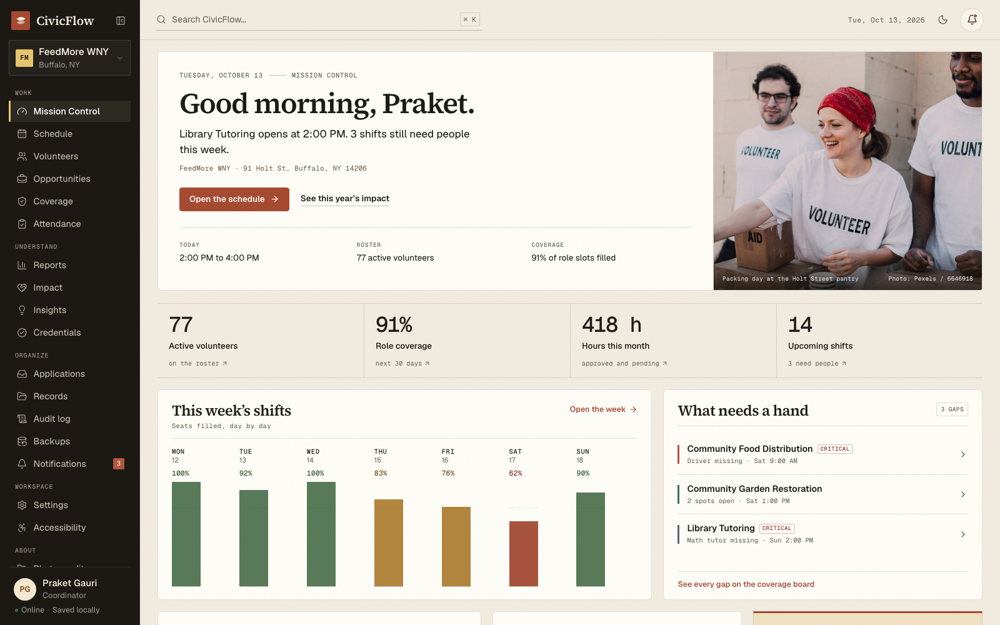

# CivicFlow

**Volunteer coordination with explainable staffing.** CivicFlow connects volunteers to
service opportunities and gives coordinators a local-first picture of who is serving,
where coverage is thin, and why every assignment was made.

This repository implements the approved CivicFlow build plan and every one of the 42 approved
design references. Fifty routes are registered today, and each one resolves to a real screen.
Mission Control, every workflow write, and the audit trail are backed by Rust and SQLite. Accounts sign people in — locally, or through Supabase Auth with Google and email —
and the core enforces coordinator and volunteer roles before it returns a row. The React
session layer is a cache of one snapshot returned by the core.



## What is here

- **50 registered screens, one design system.** Every route resolves to a real screen, plus
  the added account, organization and question-box surfaces. No placeholder pages remain. The
  mapping from reference image to route is in [SCREEN_MAP.md](docs/SCREEN_MAP.md).
- **Coordinator operations.** Mission Control, coverage and AutoRoster, schedule, programs,
  live rosters, attendance, the kiosk, hours review, credentials, recruitment, analytics,
  reports, records, audit, backups, settings, accounts, and accessibility.
- **Volunteer service.** Home, discovery and opportunity detail, saved shortlist, schedule,
  shift preparation, check-in, hours, verification, personal impact, notifications, and
  profile.
- **Ask CivicFlow.** A question box over the same snapshot: "Which shifts are short this
  week?", "Who can replace Maya on Saturday?", "Whose credentials expire soon?". Answers are
  computed by fixed rules in `src/lib/ask/answers.ts`, cite the rows they read, and link to
  the screen where the coordinator acts. No model, no network, and a plain refusal when the
  records do not cover the question.
- **One read model.** Volunteers, shifts, roles, coverage, hours, credentials, applicants,
  and audit events come from `src/lib/workspace/selectors.ts`; screens do not keep private
  mock arrays. Saved opportunities, attendance, waitlist, registrations, hours decisions,
  applicants, settings, created programs, and audit events come from one SQLite-backed
  snapshot.
- **Rust core.** Coverage rules, schema, migrations, seed, mission-control read models, and
  every workflow command live in `src-tauri/core` with integration tests. Each command
  validates the transition, writes SQLite, and appends its audit event before returning the
  fresh snapshot.
- **Free-licensed photography.** Pexels and Wikimedia images under `public/media`, credited
  in [OPEN_SOURCE_CREDITS.md](docs/OPEN_SOURCE_CREDITS.md). Reference mocks are never
  bundled.
- **Accessibility and language.** Semantic landmarks and headings, a skip link, labeled
  controls and tables, text-plus-icon statuses, visible focus, reduced motion, high
  contrast, underlined links, text scaling, a table alternative under every chart, and a
  60-language interface with translated dates and right-to-left layout. The accessibility
  tree and a 200% zoom viewport are audited on every route.
- **Accounts and roles.** Create an account from `/create-account` as a coordinator or a
  volunteer; a volunteer account joins the roster (claiming an existing profile when the email
  matches one) and the app then shows that person, not the demo volunteer. Argon2id password
  hashes, hashed session tokens, roles enforced in Rust, and a volunteer snapshot that
  contains only the signed-in volunteer's records. See [SECURITY.md](docs/SECURITY.md).
- **Hosted sign-in, optional.** With `VITE_SUPABASE_URL` and `VITE_SUPABASE_ANON_KEY` set,
  accounts can sign in with Google or an emailed password instead. Supabase verifies the
  identity, the app then opens the matching local workspace account, and the role is enforced
  in Rust either way. Without the keys the app makes no account request at all. Setup and
  limits are in [AUTH.md](docs/AUTH.md).

## Run it

```bash
pnpm install
pnpm dev              # browser preview at http://localhost:5173
pnpm tauri dev        # native desktop window
pnpm verify           # typecheck, lint, format, tests, web build, browser and Rust gates
pnpm test:native      # WebdriverIO against the real macOS window (build it first)
pnpm build:native:test
pnpm db:verify        # read-only health check of the live desktop database
pnpm tauri build      # .app and .dmg on macOS; installers on Windows/Linux
```

Demo accounts: `praket@feedmorewny.org` (coordinator) and `maya.chen@gmail.com`
(volunteer), both with the password `civicflow-demo`. Entry points: `/launch`, `/welcome`,
`/sign-in`, `/create-account`, `/coordinator/mission-control`, `/volunteer/home`,
`/coordinator/kiosk`, `/ask`, and the in-app guide at `/help`. After the desktop app has run,
`pnpm db:verify` checks the real SQLite file: integrity, schema v6, all 32 tables, foreign
keys and record counts. The kiosk
displays the current six-digit code; it rotates every 15 minutes and is validated by the
Rust core, so there is no fixed code to memorize. The volunteer screen also renders a
`civicflow://checkin/<token>` QR code that the kiosk can scan. Workspace data never leaves
the device. The app is fully usable offline; hosted sign-in with Google or email is optional
and only speaks to Supabase when its two keys are configured.

## Architecture

```text
React 19 + TypeScript + Vite  →  WorkspaceRepository  →  Tauri IPC  →  civicflow-core (Rust)
                                                       └── browser fallback (no native host)
```

- `src-tauri/core` is an independent crate: authoritative coverage rules, SQLite schema,
  workflow commands, deterministic seed, and `cargo test` coverage. It has no Tauri
  dependency.
- `src-tauri/src/lib.rs` opens the database and exposes thin IPC wrappers over the core.
- `src/lib/workspace/` holds the repository boundary, selectors, and a provider that loads
  one snapshot. `previewRepository.ts` is a clearly scoped fallback used only when
  `isTauri()` is false; it is never selected in the desktop shell.
- The same `shared/demo-workspace.json` and `shared/session-seed.json` seed both the desktop
  database and the browser fallback, so reviews never run against a second set of numbers.

See [ARCHITECTURE.md](docs/ARCHITECTURE.md), [AUTH.md](docs/AUTH.md),
[DECISIONS.md](docs/DECISIONS.md), [IMPLEMENTATION_STATUS.md](docs/IMPLEMENTATION_STATUS.md),
and the NYS event audit in [FBLA_NYS_RUBRIC_AUDIT.md](docs/FBLA_NYS_RUBRIC_AUDIT.md).

## Verification

- `pnpm typecheck`, `pnpm lint`, `pnpm format`, `pnpm build:web`: clean.
- 180 frontend tests: axe checks across all 50 routes, coverage maths, selector consistency,
  the IPC command/argument map including the session token, preview cancellation recovery,
  the preview fallback, hosted identity and email-link parsing, preview snapshot restore, and
  the Ask CivicFlow matcher and totals.
- 71 Rust tests: migrations/seed, foreign keys, account creation and its refusals, hosted
  account linking, coverage
  totals, attention ordering,
  notifications and their audience scoping, sign-in/sign-out, role refusal, volunteer
  snapshot redaction, registration and check-in rules including QR payloads, the AutoRoster
  flow solver and its brute-force oracle, the cancellation → waitlist → hours → verification
  lifecycle, report totals and exports, impossible writes, and backup restore/validation.
- WebdriverIO drives the embedded WebDriver server inside the real macOS window: sign-in,
  coordinator Mission Control, volunteer route refusal, sign-out, volunteer home, and
  coordinator route refusal. `pnpm test:native` is part of CI.
- The accessibility-tree audit reads Chromium's accessibility tree for all 50 routes and
  requires a main landmark, one `h1`, and names on every interactive control. The 200% zoom
  audit renders an 800 × 500 CSS viewport and fails on horizontal overflow or a lost heading.
- All 50 registered routes plus `/help` and `/credits` captured at 1600 × 1000 and compared
  against their references during the visual sweep; the same set was checked at 1280, 1024, 820 and 390.
  Representative captures are in `screenshots/`; notes and reference defects are in
  [VISUAL_QA.md](docs/VISUAL_QA.md).
- `pnpm db:verify` reports the live desktop database path, integrity, schema version, table
  count, foreign-key status and record counts without writing to it.

Details in [TESTING.md](docs/TESTING.md).

## Install a release

Download the installer for your machine from [Releases](https://github.com/Praket7/civicflow/releases/latest).
Signed releases open normally. If a build is published without signing credentials, the
first launch needs one extra confirmation:

- **macOS** — open the `.dmg` for your chip (`aarch64` for Apple silicon, `x64` for Intel)
  and drag CivicFlow to Applications. Double-click it once. If macOS says it cannot verify
  the app, click **Done**, then open **System Settings → Privacy & Security**, scroll to
  **Security**, and choose **Open Anyway**. You can also run
  `xattr -dr com.apple.quarantine /Applications/CivicFlow.app` in Terminal, then open it.
- **Windows** — run the `.msi` or `-setup.exe`. If SmartScreen appears, choose **More info →
  Run anyway**. The installer fetches WebView2 when it is missing.
- **Linux** — install the `.deb` with `sudo apt install ./CivicFlow*_amd64.deb`, or
  `chmod +x` the AppImage and run it. The deb needs GTK 3 and WebKitGTK 4.1; the AppImage
  still uses the system WebKitGTK.

Verify a download against `SHA256SUMS.txt` on the release:

```bash
sha256sum -c SHA256SUMS.txt      # macOS: shasum -a 256 -c SHA256SUMS.txt
```

## Build a release

`pnpm tauri build` produces `src-tauri/target/release/bundle/macos/CivicFlow.app` and a
`.dmg` on this machine. Pushing a `v*` tag runs `.github/workflows/release.yml`, which
builds installers for macOS (Apple silicon and Intel), Windows x64, and Linux x64, attaches
them to the GitHub release, and publishes SHA-256 checksums. Signing and notarization secrets are documented in
[SIGNING.md](docs/SIGNING.md); without them the release is still built, but marked
unsigned in its notes.

## Known limits

- Snapshots use SQLite's online backup API; restore validates the artifact and applies it in
  place, keeping a pre-restore safety snapshot. The newest 20 snapshots are kept and older
  files are pruned automatically. CSV and PDF reports are generated in Rust and written
  through the save dialog.
- The workspace is single-tenant and single-device. Accounts separate the coordinator from
  the volunteer and every IPC command checks the session, but there is no multi-user sync
  or server-side identity provider.
- Kiosk mode is an authenticated coordinator route in the same window. It is not a separate
  capability-scoped webview, so it does not create an OS-level kiosk boundary.
- QR scanning needs camera permission. The six-digit code remains the fallback when a
  camera is unavailable or denied.
- Code signing and notarization need certificates the repository does not carry. macOS
  builds are ad-hoc signed, so Gatekeeper offers **Open Anyway** after the first double
  click; Windows builds are unsigned, so SmartScreen offers **More info → Run anyway**.
  [SIGNING.md](docs/SIGNING.md) lists the secrets that remove both prompts.
- The accessibility tree and 200% zoom checks are automated; a human VoiceOver or NVDA pass
  on the packaged build has not been recorded.
